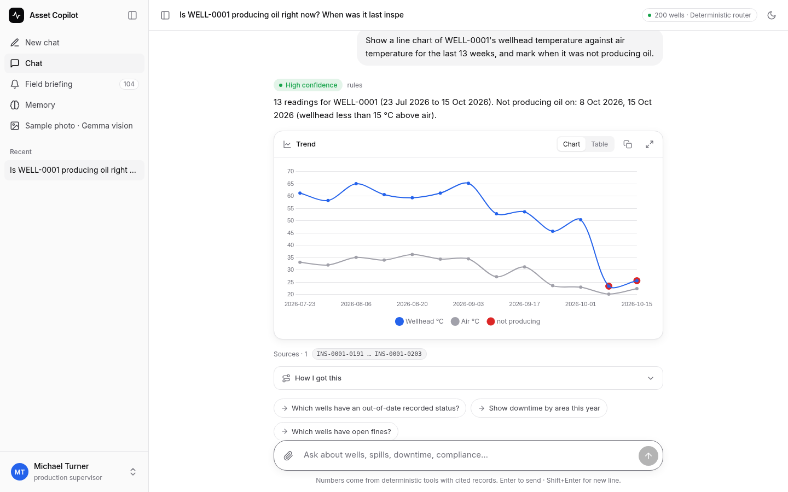
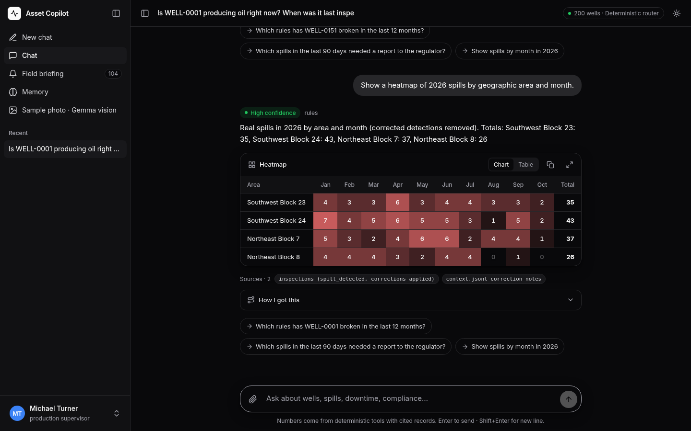
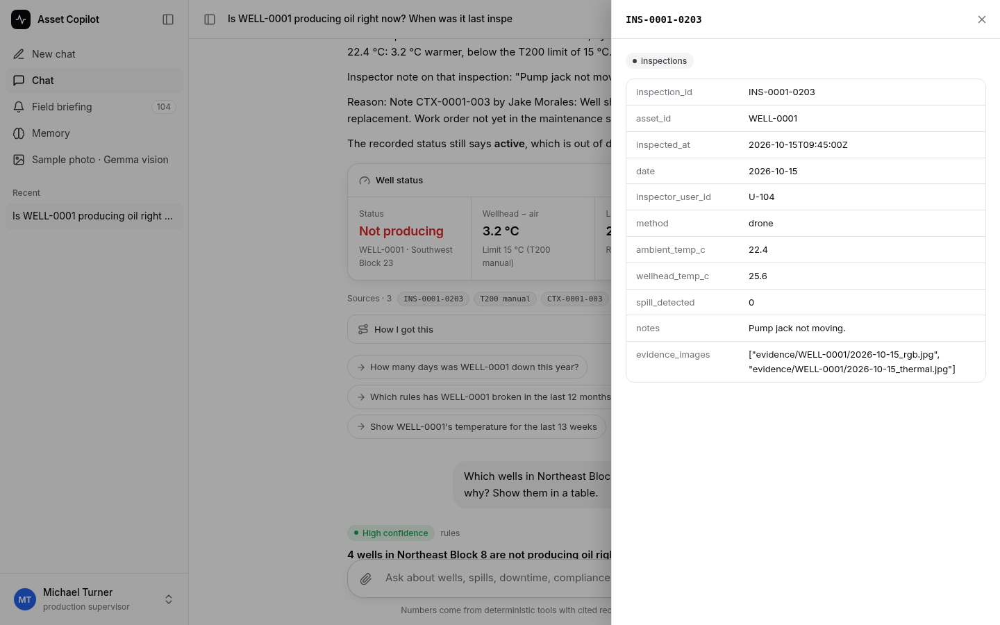
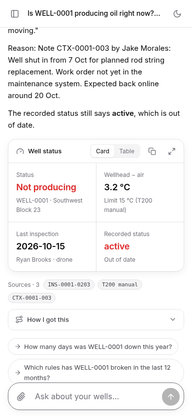

# Asset Intelligence Copilot

FlytBase challenge · AI Hackers Collective × Hacktoberfest 2026 Hack Day · **open source (MIT) · powered by open-weight Gemma 4**

A chat copilot for oil-field operators. It answers plain-English questions about wells with **numbers computed by deterministic tools, citations to record IDs and SOP passages, and a generated visual** (status card, table, line chart, bar chart, map, heatmap). It remembers shared facts about wells, keeps each user's conversations private, learns from corrections at the right scope (one inspection, or every well of a type) with provenance, and says so when people disagree with the data or with each other.

| Check | Result |
|---|---|
| 18 example scenarios (27 checks) | **27/27** (`results/examples_rules.md`) |
| 46 unseen questions, expected answers computed independently from raw files (`eval/gen_unseen.py`) | **46/46** (`results/unseen_rules.md`) |
| pytest | **94 passed** |
| Final-hour command on a synthetic 400-well test set | **~2 s** end to end |

Docs: [system design (page 1)](docs/writeup.md) · [results template (page 2)](docs/results_template.md) · [video script](docs/video-script.md)

## Gemma 4 (open-weight) in the LLM layer
* **Default model:** Gemma 4 31B (`gemma-4-31b-it`), with Gemma 4 26B as fallback. Provider order: **Gemini API** (`GEMINI_API_KEY`), then OpenRouter (`OPENROUTER_API_KEY`, `google/gemma-4-31b-it:free`), then local Ollama (`AIC_LLM_BASE=http://localhost:11434/v1`, `gemma4:*`).
* **Planner:** when the rule router isn't confident, Gemma 4 fills a structured query (metric × scope × window × group-by) through function calling, with a JSON fallback for endpoints without tools. Arguments are validated; an empty or invalid result triggers one retry via the rule router. The rule router stays authoritative when it's confident.
* **Answer phrasing:** Gemma 4 writes a short plain-language summary under each answer. It's rejected automatically if it contains any number not present in the tool output.
* **Multimodal:** upload an inspection photo (📷) and Gemma 4 describes the equipment, any staining and the % of pad, alongside the well's records. This is advisory only and never overrides data. A sample photo is included.
* Numbers never come from the model. Every LLM failure falls back to the deterministic router, and planner picks are cached, so rate limits can't block a run.

## Interface
A product-style chat UI written in hand-built CSS with no build step: a collapsible sidebar (new chat, per-user chat history, field briefing, memory, user picker), a centred 760 px conversation column, and a sticky auto-growing composer with photo attach.
* Every visual sits in a consistent card with Chart/Table switch, copy-as-CSV and expand. Citations are pills that open the evidence sheet (a right sheet on desktop, a bottom sheet on mobile).
* Each answer has a collapsible "How I got this" trace and follow-up chips.
* Light and dark themes follow the system setting. Keyboard: Enter / Shift+Enter / Esc.
* Checked with Playwright at 1440×900, 1280×800, 768×1024 and 390×844: no console errors, no horizontal overflow, CLS < 0.02.

| Desktop (light) | Desktop (dark) |
|---|---|
|  |  |
| **Evidence drawer** | **Mobile (390×844)** |
|  |  |

## Architecture

```
dataset folder(s) ──► copilot/loader.py ──► SQLite (data/copilot.db)
                       • raw tables: wells, equipment, inspections, maintenance (+ report text,
                         parsed containment hours), reg_events, notes, documents, rules
                       • rules parsed from manuals/SOPs (thresholds, deadlines) — not hard-coded
                       • memory_* tables survive reloads
                                   │
                    copilot/tools.py  (deterministic, unit-tested)
   effective_inspections ← raw + correction notes + runtime corrections (originals kept)
   well_status · area_not_producing · temp_series · spills · downtime · downtime_ranking
   spill_heatmap · spill_compliance/compliance (SR-01/02/03, RC-02, RC-04, RCA)
   containment_breaches · reportable_spills · rca_check · repair_costs · spill_detail · search_docs
                                   │
                    copilot/agent.py
   1. feedback detection → correction / type-wide rule / shared well fact (with conflict check)
   2. memory recall ("wells we discussed yesterday") from this user's own past chats only
   3. intent routing: LLM tool-calling (if a key is set) or rule-based router (fallback)
   4. answer + citations + visual (user-requested visual wins, else the fitting one)
                                   │
          copilot/server.py (FastAPI)  ──►  web/index.html (Chart.js, Leaflet, user picker)
```

* **Producing oil** = wellhead − ambient ≥ the per-type threshold parsed from the manual (T200: 15 °C, T350: 20 °C).
* **Downtime** = 7 days per non-producing weekly inspection in the period; missed inspections add nothing. Causes come from overlapping/triggered repairs and dated notes.
* **Corrections** (`note_type=correction`) void the detection of the named inspection.
* **Spill rules** from the Spill Response SOP: reportable ≥ 5 bbl, written notice ≤ 24 h (2 h major), containment ≤ 4 h, agency verification ≤ 60 days; RC-04 NOV response ≤ 30 days. Containment times are parsed from the free-text repair reports.
* **Periods**: "today" = `AIC_TODAY` (default 2026-10-17); "last N months/days" end yesterday; repairs belong to a period by start date.

## Composable query, planner and self-check
`copilot/query.py` turns any question into **metric × scope × window × group-by** (metrics: downtime, spills, spill_volume, repairs, repair_cost, fines, reg_events, not_producing, stale_status, notes; scope: well/area/type/team/field; windows: right now, last N days/weeks/months, season, month, quarter, half, between dates, a year; groups: well/area/type/team/month/equipment). The LLM planner (used only when the rule router isn't confident) fills the same structure; args are validated and an empty or invalid result triggers one retry through the rule router.

## Demo features
Field briefing panel (`/api/briefing`), evidence drawer (`/api/evidence?ref=MNT-0001-029` → raw record + highlighted report/SOP passage), "How I got this" trace (tools, args, rules with source docs), confidence/conflict badge, follow-up chips, step progress, dark/light theme.

## Memory and corrections

| Level | Table | Scope | Example |
|---|---|---|---|
| Private conversation memory | `memory_conversations` (user, chat, ts, question, answer, wells) | one user | "the three wells we discussed yesterday" resolves only from *this* user's earlier chats; another user gets "no earlier conversation". |
| Shared well knowledge | `memory_well_facts` (well, author, text, kind, status, conflict) | all users | "WELL-0007 will be shut in from 17 Oct…" is shown to anyone asking about WELL-0007, attributed to the author. |
| Raw-data / AI-analysis corrections | `memory_corrections` (inspection, field, original, corrected, author, reason, conflict) | one inspection, all users | Overlaid on every query via `effective_inspections`; the original stays visible with who/why. |
| Type-wide rules | `memory_type_rules` (well_type, rule_key, value, author) | every well of that type only | "Note for all T350 wells: RCA after 2 repairs" changes T350 only; answers say it follows the user's rule, not the manual. |

**Conflicts**: a statement about a well is compared with its latest inspection; if it contradicts the data it is stored as *unconfirmed*, the copilot says which inspection disagrees, which other user's note agrees, and asks for confirmation. A correction that contradicts an inspector note (e.g. "Pump jack not moving.") is applied but flagged. Disagreeing notes on the same inspection are shown side by side; only a formal correction overrides a detection.

## Run

```bash
git clone https://github.com/FlytBaseAILabs/flytbase-ahc-swe-asset-intelligence-dataset ../dataset
pip install -r requirements.txt
cp .env.example .env   # optional: add OPENROUTER_API_KEY, then `set -a; . ./.env; set +a`
python -m copilot.loader ../dataset/sample-data           # builds data/copilot.db
python -m uvicorn copilot.server:app --port 8000          # open http://localhost:8000
python -m pytest -q tests                                  # 94 tests
python -m eval.run_questions eval/examples.json --fresh    # 18 examples → results/examples.{md,json} + score
```

LLM (Gemma 4 by default; numbers always come from the tools): set `GEMINI_API_KEY` (Gemma 4 via the Gemini API) or `OPENROUTER_API_KEY`, or point `AIC_LLM_BASE` at Ollama. Optional: `AIC_LLM_MODEL`, `AIC_LLM_PROVIDER`, `AIC_LLM_FALLBACKS`. Routing policy (`AIC_LLM`): `auto` (default) means the rule router is authoritative when it matches confidently and the LLM is only asked when it is unsure; `force` sends every question through the LLM; `0` means rules only. LLM picks are cached in `data/llm_cache.json`, a free-model fallback chain is tried (`AIC_LLM_FALLBACKS`), the timeout is `AIC_LLM_TIMEOUT` (20 s), and any error falls back to the rule router, so rate limits cannot block a run.

## Tests

```bash
pip install -r requirements-dev.txt
AIC_DATA=/path/to/sample-data python -m pytest -q tests   # 94 tests: tools, raw-data recomputation, memory scopes, corrections, 18 examples, API
```
`tests/test_raw_recompute.py` recomputes key expected answers straight from the raw JSON (no copilot code), so the example checker is not just matching strings. Tests use a temporary DB and never touch the running server's memory.

## Deploy

* **Docker:** `docker build -t aic . && docker run -p 8000:8000 -e OPENROUTER_API_KEY=... aic`. The image bakes in the public sample dataset; to add the test set, mount it and set `DATA_DIRS="/data/sample-data /data/extra"`.
* **Render (one step):** New → Blueprint → pick this repo (`render.yaml`), set `OPENROUTER_API_KEY`. Health check: `/api/healthz`.
* Any Docker host (Fly, Railway, Cloud Run) works the same way: the container listens on `$PORT`.

## Final hour (one command)
```bash
python scripts/final_run.py --data /path/to/test-data --questions final_questions.txt   # add --today YYYY-MM-DD if needed, --no-llm for rules only
```
It loads sample + test data (memory reset), answers every question (`.txt` lines may start with `User Name:`) and writes `results/final.md`, `results/final.json` and `docs/results.md`, filled from `docs/results_template.md` (summary, answer table, what worked, what didn't). A rehearsal output is in `docs/results_rehearsal_synthetic.md`. Rehearsed on the synthetic 400-well set with 15 questions: **1.6 s end to end**.

## Loading the test dataset

The loader is idempotent and accepts several folders (same layout as `sample-data/`):

```bash
python -m copilot.loader /path/to/sample-data /path/to/test-data   # or just the test folder
AIC_TODAY=2026-10-17 python -m uvicorn copilot.server:app --port 8000   # set "today" if the test data says otherwise
# final questions: one per line in a .txt, or a JSON list of {id, q, user, chat, day}
python -m eval.run_questions final_questions.txt --out results/final
```
To dry-run this step: `python scripts/make_synthetic_dataset.py <sample-data> /tmp/test-data` builds a 200-well copy (renumbered wells, new areas). `eval/synthetic.json` checks answers on sample + synthetic loaded together (7/7, 400 wells load in about 1 s).
`--reset-memory` on the loader wipes runtime memory; otherwise it is preserved across reloads.

## Models and cost
Deterministic core: no model, $0. Optional LLM routing uses one small tool-call per question (free Gemma 4 on OpenRouter/AI Studio by default).

## Demo video
`python scripts/record_demo.py <out-dir>` drives the real UI with Playwright (1280×720), burns in captions, and writes `demo.mp4`, `demo.srt` and `narration.txt` (timed lines for the presenter's own voice). See `docs/video-script.md` for the timed script and the ffmpeg command to add the voiceover.

## Next steps
Embedding retrieval over reports, LLM-written prose on top of tool JSON, richer statement parsing for arbitrary feedback, per-chat context for follow-ups.

License: MIT

**CI:** the workflow is in `docs/ci-workflow.yml`. Copy it to `.github/workflows/ci.yml`; pushing it needs a token with the `workflow` scope.
